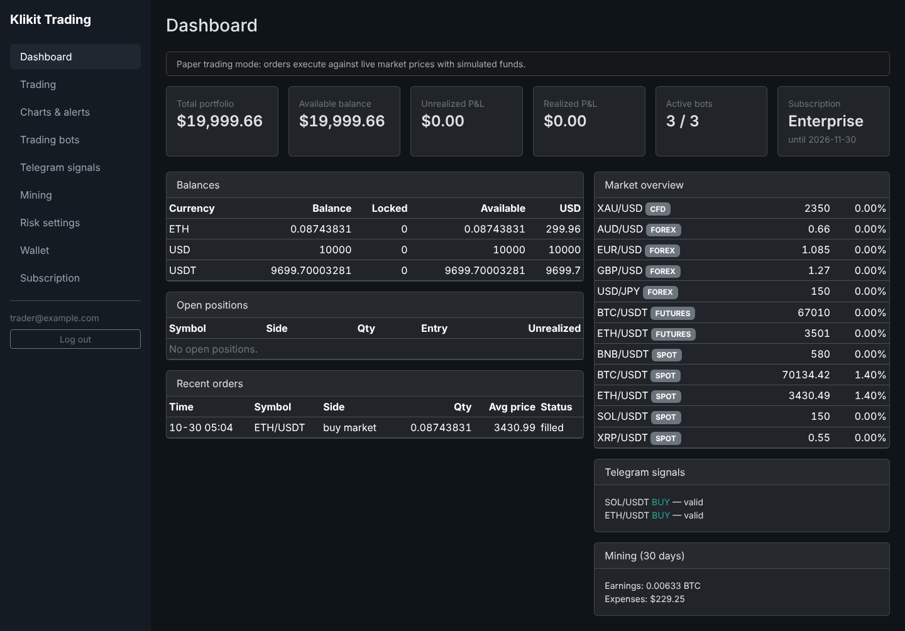
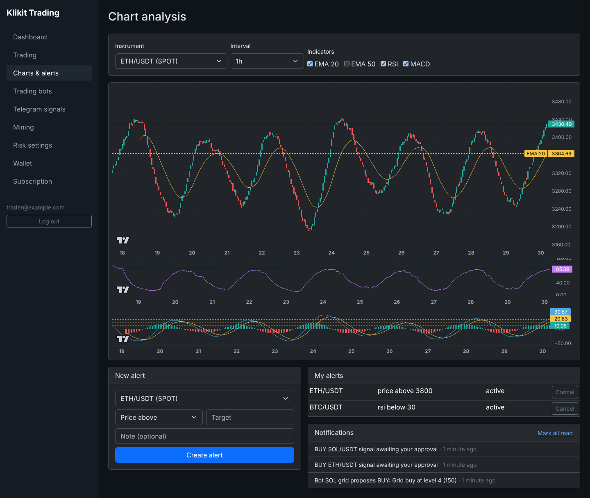
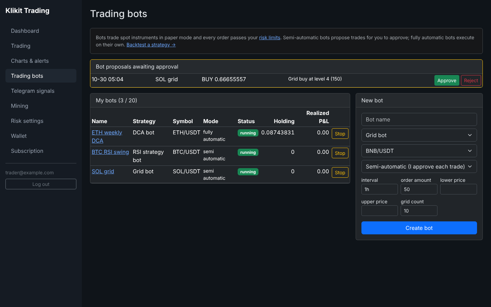
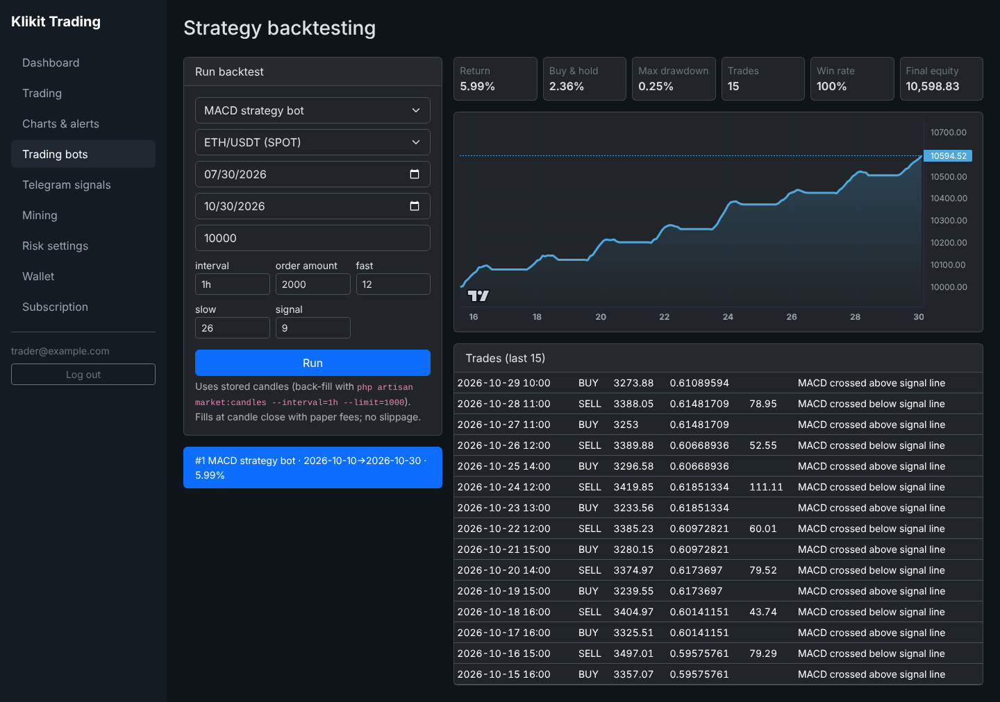
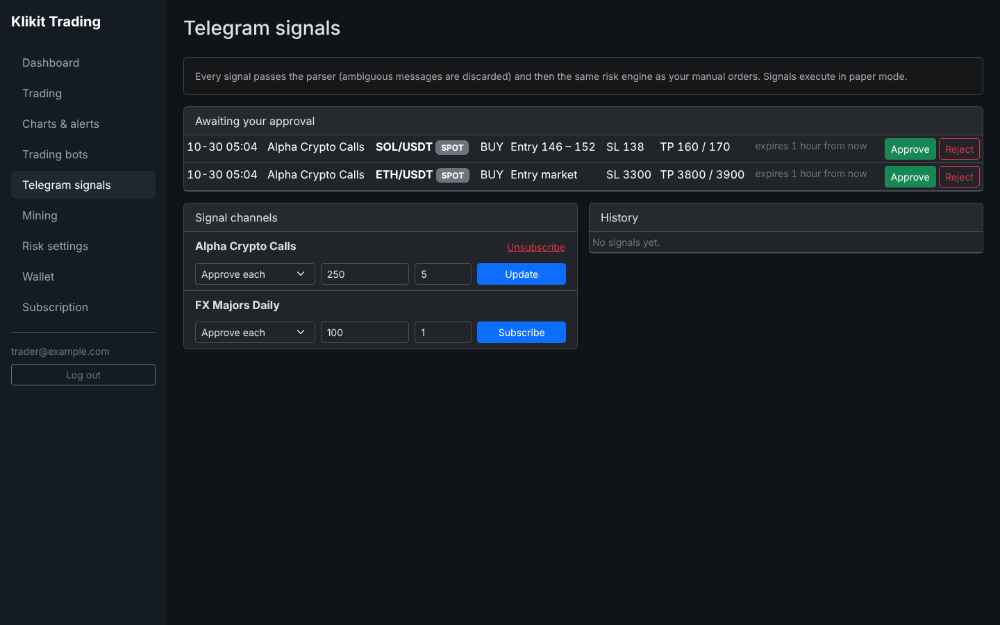
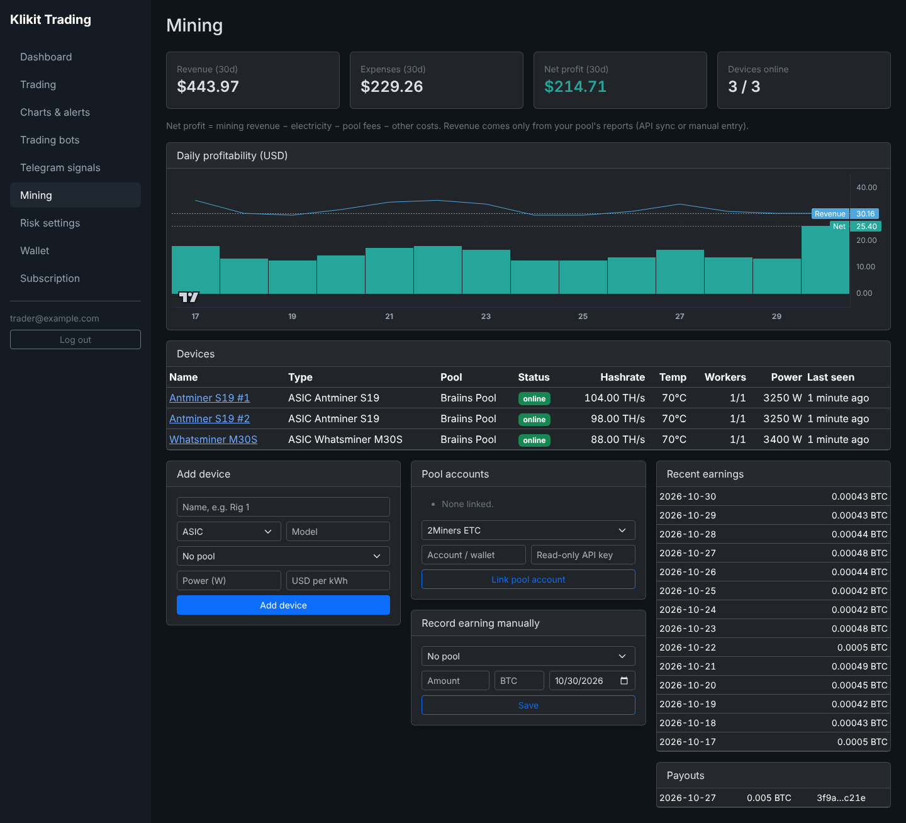

# Klikit Trading Platform

Laravel 12 + MySQL 8 + Redis multi-asset trading platform: crypto and Forex trading, Telegram
signals, chart analysis, trading bots, mining management, subscriptions and an admin back office.
All eight roadmap phases are implemented.

| Module | What it does |
| --- | --- |
| Core | Web + API auth (Sanctum), permission-based RBAC, audit log, user and admin dashboards |
| Subscriptions | Plans with editable entitlements, coupons, invoices, bank transfer + Stripe Checkout, renewals, expiry |
| Crypto & Forex | Shared risk engine, paper trading, live routing through CCXT / MT5 bridges, positions, double-entry ledger |
| Telegram signals | Bot webhook + ingest API, parser that rejects ambiguous messages, approve-or-auto execution |
| Chart analysis | OHLC candles, EMA/SMA/RSI/MACD, TradingView Lightweight Charts, price and RSI alerts |
| Trading bots | Grid, DCA, scalping, trend, RSI, MACD strategies; semi/fully automatic; performance; backtesting |
| Mining | Devices, hardware agent, pool API sync, payouts, electricity/pool-fee/net-profit accounting |
| Production | Horizon queues, health checks, backups, security headers, Docker, nginx/supervisor, CI, k6 load test |

Live order routing is **off by default** (`TRADING_LIVE_ENABLED=false`): every order runs through
the paper-trading adapter against real stored prices until you have completed the go-live
checklist in [docs/DEPLOYMENT.md](docs/DEPLOYMENT.md).

## Screenshots

| User dashboard | Chart analysis |
| --- | --- |
|  |  |
| **Trading bots** | **Backtesting** |
|  |  |
| **Telegram signals** | **Mining** |
|  |  |

More in [`docs/screenshots`](docs/screenshots).

## Quick start (local)

```bash
composer install
cp .env.example .env && php artisan key:generate
# Without MySQL/Redis: DB_CONNECTION=sqlite, QUEUE_CONNECTION=database, CACHE_STORE=database
php artisan migrate --seed                 # roles, plans, venues, instruments, strategies, pools
php artisan market:candles --interval=1h   # optional: chart/backtest history from Binance
php artisan serve
php artisan horizon                        # or: php artisan queue:work --queue=trading,default
php artisan schedule:work
```

With `APP_ENV=local` the seeder creates `admin@example.com` (super admin) and
`trader@example.com`, password `password123`. Production staff accounts:
`php artisan admin:create you@company.com --role=super_admin`.

Tests: `php artisan test` (113 tests; CI also runs them against MySQL), `npm test` in
`services/execution-bridge`, `python -m unittest test_bridge.py` in `services/mt5-bridge`.

## Architecture

```
app/
├── Models/                 Eloquent models (≈60 tables)
├── Modules/<Module>/Http/  Controllers per module: Auth, Dashboard, Trading, Wallet,
│                           Subscriptions, ChartAnalysis, Signals, TradingBots, Mining, Administration
├── Services/
│   ├── Trading/            TradingEngineService, RiskManagementService, SettlementService,
│   │                       ExecutionRouter, adapters (paper, CCXT bridge, MT5 bridge), market data
│   ├── Accounting/         LedgerService (double entry), WalletService
│   ├── Subscriptions/ Payments/   entitlements, checkout, Stripe + manual gateways
│   ├── Analysis/           candles, indicators, chart data, price alerts
│   ├── Signals/            parser, signal pipeline, Telegram Bot API client
│   ├── Bots/               strategies, bot runner, positions/performance, backtester
│   └── Mining/             device agents, pool clients, profitability
├── Jobs/ExecuteOrderJob    dedicated `trading` queue (Horizon supervisor)
services/
├── execution-bridge/       Node + CCXT live crypto execution (stateless, token-protected)
└── mt5-bridge/             Python MetaTrader 5 bridge for Forex/CFD (Windows host)
tools/mining-agent/         CGMiner-API agent that reports rig stats
deploy/                     nginx, supervisor, php.ini, deploy script
```

### One path for every order

```
Manual order · Telegram signal · Bot decision
      └─► OrderIntent ─► RiskManagementService ─► funds reserved + Order(pending)   (one DB transaction,
                                                                                    idempotency key)
          ─► ExecuteOrderJob (trading queue) ─► ExecutionRouter ─► paper | CCXT bridge | MT5 bridge
          ─► SettlementService: executions, trades/positions, ledger postings (paper), release reservation
```

Risk checks: account status, platform halt, personal kill switch, plan, quantity, leverage,
stop-loss rules, per-trade size, daily realised loss, open positions, total exposure, and for
live orders a verified trade-scope venue account. Limits are evaluated in USD equivalent.

### Accounting

User wallets are ledger liability accounts. `LedgerService` refuses unbalanced postings,
cached balances change only in the same transaction as their entries and cannot go negative,
and `ledger:verify` (daily) recomputes every wallet. Live exchange/broker accounts are
non-custodial: funds stay at the venue.

### Signals

Supported layouts include `BUY BTC/USDT Entry: 67000-67500 TP1: 68000 SL: 66000 Leverage: 10x`,
`#ETHUSDT LONG Entry 3500 Targets 3600 3700 Stop 3400` and `EURUSD SELL @ 1.0850 TP 1.0800 SL 1.0900`.
Messages without a clear direction, instrument, entry, stop-loss and consistent targets are
logged as ambiguous and never traded. Subscribers choose manual approval or auto-execution,
an amount per signal and a leverage cap; signals expire after the channel's TTL.

### Bots and backtests

Strategies receive the same `StrategyContext` in live runs (`bots:run`, every minute, closed
candles only) and in backtests, so results are comparable. Bot holdings and P&L are derived from
the orders that actually filled. Bots trade spot instruments in paper mode.

### Mining

Hardware reports via `tools/mining-agent/agent.py` with a per-device token. Revenue comes only
from pool reports (JSON pool API or manual entry), is split between a user's devices by
hashrate, and `net profit = revenue − electricity − pool fees − other costs`.

## Plans and entitlements

| Feature key | Free | Starter | Pro | Enterprise |
| --- | --- | --- | --- | --- |
| trading.paper / trading.manual | ✓ / – | ✓ / ✓ | ✓ / ✓ | ✓ / ✓ |
| charts.advanced (RSI, MACD, backtests) | – | – | ✓ | ✓ |
| signals.telegram / signals.daily_limit | – / 0 | – / 5 | ✓ / 50 | ✓ / unlimited |
| bots.automated / bots.max | – / 0 | – / 0 | ✓ / 3 | ✓ / 20 |
| alerts.max | 3 | 10 | 50 | unlimited |
| mining.management, analytics.advanced | – | – | – | ✓ |

Admins edit prices and values at `/admin/plans`.

## REST API (v1)

Bearer token from `POST /api/v1/auth/login`. Writes marked **(I)** require an `Idempotency-Key`
header; replays return the stored response, a reused key with another body returns 422.

| Area | Endpoints |
| --- | --- |
| Auth | `POST auth/register`, `auth/login`, `auth/logout`, `GET/PUT auth/profile` |
| Dashboard | `GET dashboard/overview`, `dashboard/statistics`, `notifications` |
| Crypto / Forex | `GET {crypto\|forex}/markets`, `/prices`, `/orders`, `/trades`; `POST /orders` (I), `/orders/{id}/cancel` (I) |
| Positions & risk | `GET positions`, `POST positions/{id}/close` (I), `GET/PUT trading/risk-profile`, `POST trading/emergency-stop` |
| Venue accounts | `GET accounts`, `POST accounts/{exchanges\|brokers}`, `POST …/{id}/verify`, `DELETE …/{id}` |
| Charts & alerts | `GET charts/{symbol}?interval=1h&indicators=ema:20,rsi,macd`, `GET/POST/DELETE alerts` |
| Signals | `GET signals`, `signals/history`, `signals/channels`; `POST/DELETE signals/channels/{id}/subscribe`; `POST signals/executions/{id}/approve` (I) / `reject` |
| Bots | `GET/POST bots`, `GET/PUT/DELETE bots/{id}`, `POST bots/{id}/start\|stop`, `POST bots/signals/{id}/approve` (I) / `reject`, `GET/POST bots/backtests` |
| Mining | `GET/POST mining/devices`, `GET/DELETE mining/devices/{id}`, `POST …/token`, `POST …/expenses`, `GET mining/statistics`, `mining/profitability`, `POST mining/pool-accounts`, `mining/earnings` |
| Wallet | `GET wallet/balances`, `/transactions`, `POST wallet/paper/reset`, `GET/POST wallet/deposits` (I), `wallet/withdrawals` (I) |
| Subscriptions | `GET subscriptions/plans` (public), `/current`, `/invoices`, `POST /checkout` (I), `/cancel` |
| Machine endpoints | `POST mining/agent/stats` (device token), `POST signals/ingest/{channel}` (`X-Signal-Secret`), `POST /telegram/webhook/{bot}`, `POST /webhooks/stripe` |

## Scheduled jobs

| Command | Schedule | Purpose |
| --- | --- | --- |
| `market:sync` | minute | Public Binance spot prices; every tick also updates candles |
| `trading:sync-orders` | minute | Fill marketable paper limit orders, reconcile live orders |
| `alerts:check`, `signals:expire`, `bots:run` | minute | Alerts, signal expiry, bot evaluation |
| `mining:profitability` | 15 min | Offline detection and daily profitability |
| `bots:performance`, `subscriptions:expire`, `mining:sync-pools` | hourly | Snapshots, expiry, pool earnings |
| `backup:database`, `ledger:verify`, `accounts:verify`, `subscriptions:renew` | daily | Backups, reconciliation, key checks, renewal invoices |

## Operations

- `/up` liveness, `/health` readiness (database, cache, scheduler heartbeat, market-data age).
- `/horizon` queue dashboard (permission `system.monitor`); the `trading` queue has its own
  supervisor and its jobs are never retried automatically.
- Deployment, go-live checklist and backups: [docs/DEPLOYMENT.md](docs/DEPLOYMENT.md).
  Security model and checklist: [docs/SECURITY.md](docs/SECURITY.md).

Before offering live trading, custody or paid services, confirm the financial-services,
brokerage, custody and AML/KYC requirements for each jurisdiction you operate in.
